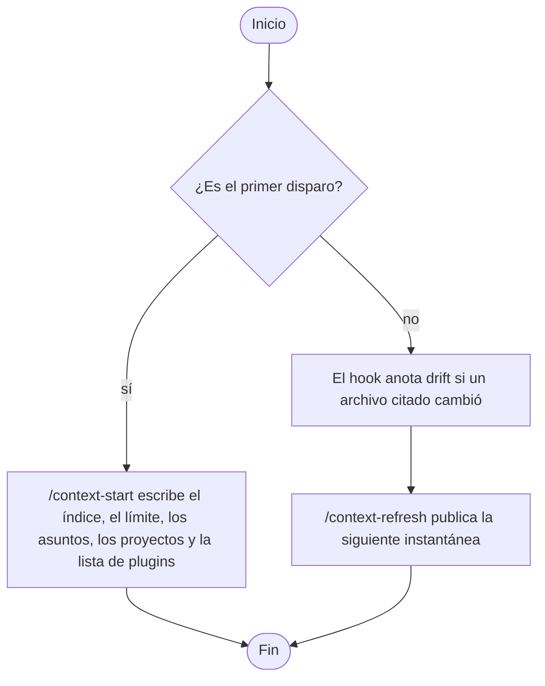

<p align="right">Idioma:&emsp;<a href="README.md" style="vertical-align:middle"></a> </p>

# Contexto del proyecto (`plugin-project-context`)

Deja una foto vigente del proyecto para que una tarea posterior abra un índice corto y un corte, no el repositorio entero. Cubre un proyecto, varios en el mismo workspace, y un proyecto cuya forma todavía no se conoce.

Cada pieza vive en `skills/maintain-context/references/`. El resultado es Markdown en `project-context/`.

Las instrucciones están en inglés. El archivo que guarda el plugin sigue el idioma del pedido.

## Empezar

El primer escaneo no arranca solo. El hook de la sesión solo marca deriva cuando ya hay una foto.

Escribe `/context-start`. Deja la primera foto en `project-context/`: el índice, el límite, un corte por cada asunto que tenga fuente, el mapa y la recomendación cuando se leyó una señal. Un asunto sin fuente, y una recomendación sin señal, no son archivos. También escribe una frase en `AGENTS.md` en la raíz del proyecto, para que el agente abra el índice aceptado. Si esa frase ya está, el archivo se queda igual. Un propósito o una entidad externa que el repositorio no dice queda «no observado». No refresca.

Las mismas piezas, una por vez, siguen siendo `/context-index`, `/context-boundary`, `/context-slice`, `/context-map` y `/context-recommend`.

El primer disparo y la actualización posterior están en [Orden de los commands](#orden-de-los-commands).

## Orden de los commands

Dos caminos. En el primer disparo aún no hay foto: `/context-start` escribe el índice, el límite, los asuntos que tengan fuente, los proyectos y la lista de plugins cuando se leyó una señal. Cuando la foto ya existe, el camino es la actualización: el hook escribe `drift:` si un archivo citado cambió, y `/context-refresh` publica la siguiente instantánea. El primer camino no arranca solo.



La figura de arriba es el orden. La actividad UML 2.5.1 con los mismos dos caminos se dibujó en el workspace que la pidió. No es un archivo de este repositorio. PlantUML dibuja esa actividad de forma nativa.

## Para quién es

Para quien quiere que el agente sepa qué es este proyecto antes de que empiece otro oficio. La descripción de arquitectura queda en `plugin-software-architect`. El dibujo queda en `plugin-uml-diagrams`. El modelo de dominio queda en `plugin-backend`. El documento para un lector queda en `plugin-documentation`. La recuperación para un modelo queda en `plugin-genai`. Este plugin no copia sus skills y no los instala.

## Qué incluye

Portable, para cualquier agente que siga [Agent Skills](https://agentskills.io/specification):

- Un skill, `maintain-context`. Lleva la carpeta de salida y las restricciones de fidelidad, para un agente que no carga rules.

Cursor y Claude Code:

- Ocho commands: `/context-help`, `/context-start` y uno por pieza. En Cursor, `/context-start`. En Claude Code, `/plugin-project-context:context-start`.

Solo Cursor:

- Rule `output-folder`, que deja cada archivo en `project-context/`.
- Rule `context-fidelity`, que ata un hecho aceptado al archivo del que se leyó.
- Hook `sessionStart` en `hooks/cursor-hooks.json`. Escribe `drift:` en `STATUS.md` cuando un archivo citado es más nuevo. No publica una instantánea.

Solo Claude Code:

- Hook `SessionStart` en `hooks/claude-hooks.json`. La misma nota de deriva, en otro archivo. La republicación portable es `/context-refresh`.

El hook necesita PowerShell. Donde no está, la actualización es `/context-refresh`.

## Instalar

En Cursor, instala el plugin desde este repositorio en Customize.

En Claude Code, este repositorio también es un marketplace:

```text
claude plugin marketplace add ADRenaline-Suite/plugin-project-context
claude plugin install plugin-project-context@plugin-project-context
```

Para probar una copia local sin instalarla, arranca Claude Code con `claude --plugin-dir <ruta de este repositorio>`.

En otro agente, instala el skill con el mecanismo de ese agente. Por ejemplo:

```text
gh skill install ADRenaline-Suite/plugin-project-context
```

## Configuración

No usa variables ni servicios.

Cada entrega se guarda en `project-context/` en la raíz del proyecto, con un `<NNN>` monótono que no se reutiliza. La carpeta mantiene `STATUS.md` (`proposed` | `accepted` | `deprecated` | `superseded`). Al elegir qué seguir, manda `accepted`. Junto a él, `ORIGIN.json` nombra este plugin (`suite`, `plugin`, `repository`, `convention` `adr-001`). No es un archivo `<NNN>`. El índice lista una carpeta como salida de la suite solo cuando ese archivo se leyó. La prosa sigue el idioma del pedido. El tipo del nombre sigue en inglés. Las columnas de `STATUS.md` siguen `N`, `archivo`, `estado`, `sustituye`, `notas`.

Para usar otra carpeta, añade `.cursor/adrenaline.json` al proyecto:

```json
{
  "outputDirs": {
    "plugin-project-context": "docs/context"
  }
}
```

La ruta es relativa a la raíz del proyecto y no puede contener `..`. Claude Code y los demás agentes leen el mismo archivo.

## Cómo pedirlo

Si un command no es familiar, lee [Para qué sirve cada command](#para-qué-sirve-cada-command) antes de las tablas.

El primer escaneo es [Empezar](#empezar): `/context-start`. En Claude Code, `/plugin-project-context:context-start`. Pedir la foto en una frase, sin command, escribe esa misma primera foto y se detiene. Un pedido en español produce un archivo en español.

Antes de cerrar, el command comprueba la lista de terminado de ese skill y de esa pieza. Un archivo que falla una comprobación se corrige en el mismo turno, o no se marca `accepted`.

Un hecho es `accepted` solo cuando cita una fuente o dice «no observado». Un corte sin fuente, una recomendación sin señal y un refresco sin `STATUS.md` no escriben nada. Una recomendación se queda en `proposed` hasta que la persona dice que esa lista es la que hay que seguir. No se instala nada.

## Para qué sirve cada command

No hace falta conocer los términos de arquitectura. Cada command escribe una pieza. `/context-start` escribe la primera foto. El skill que lo acompaña es solo el grupo.

### `/context-help`

Imprime la lista corta de skills, rules, commands y hooks. No escribe un archivo. Úsalo cuando quieras ver qué se puede pedir.

### Mantener el contexto — skill `maintain-context`

Usa este grupo para dejar escrito qué es el proyecto, qué queda fuera y qué plugins de la suite coinciden con un archivo que se leyó. No diseña el sistema y no lo dibuja.

#### `/context-start`

Escribe el índice, el límite, cada corte que tenga fuente, el mapa y la recomendación cuando se leyó una señal, y se detiene. También escribe una frase de apuntador en `AGENTS.md`. Úsalo para el primer escaneo, también cuando la forma del proyecto todavía no se conoce. El hook de la sesión no hace este paso. No refresca.

#### `/context-index`

Escribe el nombre del proyecto, el propósito cuando un archivo lo dice, y qué archivo abrir después. Úsalo primero, también cuando la forma del proyecto todavía no se conoce. Un propósito que el repositorio no dice queda «no observado».

#### `/context-boundary`

Escribe qué entra, qué queda fuera y las personas o sistemas que nombra un archivo. El proyecto se queda en caja cerrada. Úsalo cuando hace falta el límite antes de describir el interior.

#### `/context-slice`

Escribe un asunto, como cómo se arranca, las convenciones, los módulos o los huecos. Cada frase cita el archivo del que salió. Úsalo cuando una tarea posterior deba abrir ese asunto y no el resto del repositorio. Sin archivo fuente, no escribe nada.

#### `/context-map`

Escribe una fila por proyecto de este workspace y la relación que muestra un archivo entre ellos. Úsalo cuando varios proyectos comparten el workspace. Una relación que ningún archivo muestra queda «no observada». Los modelos no se mezclan.

#### `/context-recommend`

Escribe qué plugins de ADRenaline coinciden con una señal leída, como un OpenAPI o una dependencia de interfaz. La lista se queda en propuesta. Úsalo cuando quieras saber qué más instalar. No instala nada. Sin señal que coincida, no escribe nada.

#### `/context-refresh`

Lee las fuentes que citan los cortes aceptados. Si una fuente cambió, escribe el siguiente archivo y marca el anterior como sustituido. Si el propósito, el límite o la recomendación quedaron viejos, marca la deriva y nombra el command que reescribe esa pieza. No inventa un propósito nuevo. Sin una foto previa, no escribe nada.

## Skills

| Skill | Qué deja escrito |
| --- | --- |
| [maintain-context](skills/maintain-context/SKILL.es.md) | La foto, una situación cada vez |

## Piezas

| Command | Pieza | Manual |
| --- | --- | --- |
| `/context-start` | Índice, límite, cortes con fuente, mapa, recomendación cuando hay señal | [start](skills/maintain-context/references/start.es.md) |
| `/context-index` | Índice | [index](skills/maintain-context/references/index.es.md) |
| `/context-boundary` | Límite | [boundary](skills/maintain-context/references/boundary.es.md) |
| `/context-slice` | Corte | [slice](skills/maintain-context/references/slice.es.md) |
| `/context-map` | Mapa | [map](skills/maintain-context/references/map.es.md) |
| `/context-recommend` | Recomendación | [recommendation](skills/maintain-context/references/recommendation.es.md) |
| `/context-refresh` | Refresco | [refresh](skills/maintain-context/references/refresh.es.md) |

## Salida

| Archivo | Qué guarda |
| --- | --- |
| `<NNN>-index-<tema>.md` | Entidad de interés, propósito, dónde mirar después, salida de la suite |
| `<NNN>-boundary-<tema>.md` | Dentro, fuera, entidades externas |
| `<NNN>-slice-<tema>.md` | Un asunto, cada hecho con su fuente |
| `<NNN>-map-<tema>.md` | Proyectos y relaciones observadas |
| `<NNN>-recommendation-<tema>.md` | Plugins de la suite ligados a una señal, `proposed` |
| `STATUS.md` | `N`, `archivo`, `estado`, `sustituye`, `notas` |
| `ORIGIN.json` | Marcador de la carpeta: `suite`, `plugin`, `repository`, `convention` `adr-001`. No es un archivo `<NNN>` |

## Licencia

MIT. Ver [LICENSE](LICENSE).
