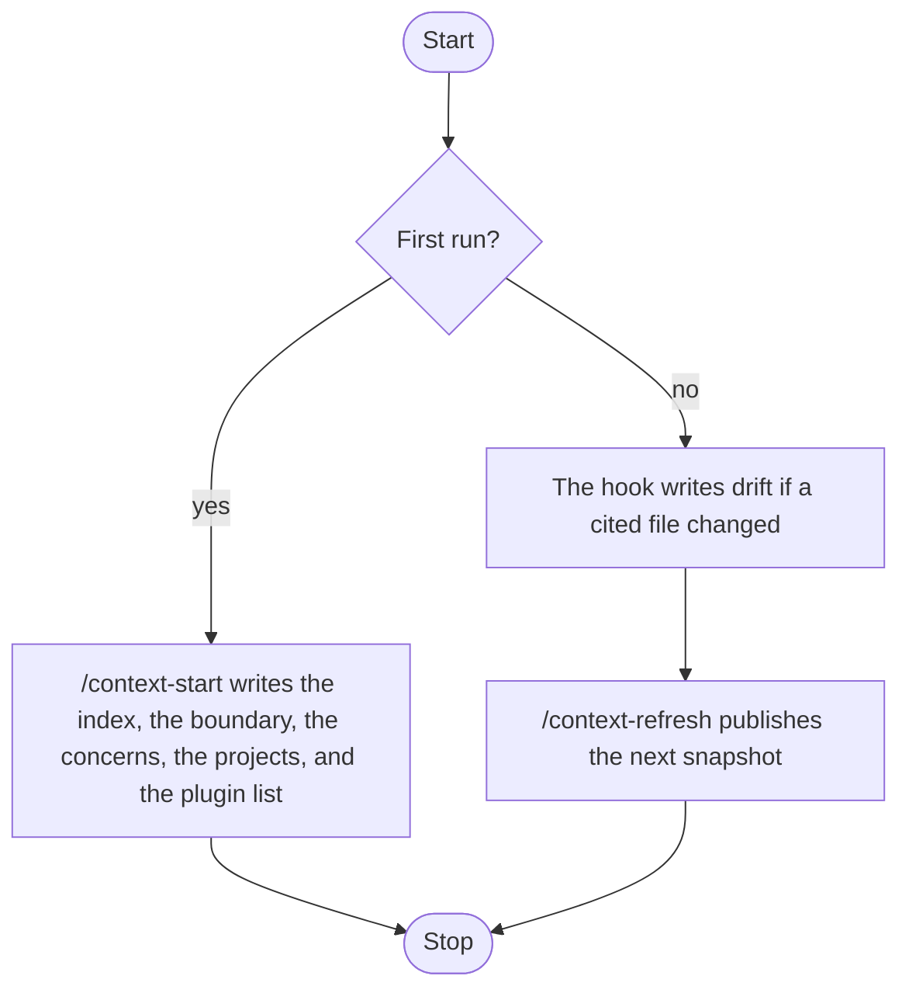

<p align="right">Language:&emsp; <a href="README.es.md" style="vertical-align:middle"></a></p>

# Project Context (`plugin-project-context`)

Records a current picture of a project so a later task can open a short index and one slice, not the whole repository. It covers one project, several projects in one workspace, and a project whose shape is not known yet.

Each piece lives in `skills/maintain-context/references/`. The result is Markdown in `project-context/`.

The instructions are in English. The file the plugin saves follows the language of the request.

## Start

The first scan does not run by itself. The session hook only marks drift after a picture already exists.

Type `/context-start`. It writes the first picture in `project-context/`: the index, the boundary, a slice for each concern that has a source, the map, and the recommendation when a signal was read. A concern with no source, and a recommendation with no signal, are not files. It also writes one sentence into `AGENTS.md` at the project root, telling the agent to open the accepted index. If that sentence is already there, the file stays as it is. A purpose or an external entity the repository does not state stays "not observed". It does not refresh.

The same pieces, one at a time, stay `/context-index`, `/context-boundary`, `/context-slice`, `/context-map`, and `/context-recommend`.

The first run and the later update are in [Order of the commands](#order-of-the-commands).

## Order of the commands

Two paths. On the first run there is no picture yet: `/context-start` writes the index, the boundary, the concerns that have a source, the projects, and the plugin list when a signal was read. When a picture already exists, that is the update: the hook writes `drift:` if a cited file changed, and `/context-refresh` publishes the next snapshot. The first path does not run by itself.



The figure above is the order. The UML 2.5.1 activity with the same two paths was drawn in the workspace that asked for it. It is not a file of this repository. PlantUML draws that activity natively.

## Who it is for

Someone who wants the agent to know what this project is before another craft starts. The architecture description stays with `plugin-software-architect`. The drawing stays with `plugin-uml-diagrams`. The domain model stays with `plugin-backend`. A document for a reader stays with `plugin-documentation`. Retrieval for a model stays with `plugin-genai`. This plugin does not copy their skills and does not install them.

## What it includes

Portable, for any agent that follows [Agent Skills](https://agentskills.io/specification):

- One skill, `maintain-context`. It carries the output folder and the fidelity restrictions, for an agent that does not load rules.

Cursor and Claude Code:

- Eight commands: `/context-help`, `/context-start`, and one per piece. In Cursor, `/context-start`. In Claude Code, `/plugin-project-context:context-start`.

Cursor only:

- Rule `output-folder`, which keeps every file in `project-context/`.
- Rule `context-fidelity`, which keeps an accepted fact tied to the file it was read from.
- Hook `sessionStart` in `hooks/cursor-hooks.json`. It writes `drift:` in `STATUS.md` when a cited file is newer. It does not publish a snapshot.

Claude Code only:

- Hook `SessionStart` in `hooks/claude-hooks.json`. Same drift note, separate file. The portable republish is `/context-refresh`.

The hook needs PowerShell. Where PowerShell is not available, `/context-refresh` is the update.

## Install

In Cursor, install the plugin from this repository in Customize.

In Claude Code, this repository is also a marketplace:

```text
claude plugin marketplace add ADRenaline-Suite/plugin-project-context
claude plugin install plugin-project-context@plugin-project-context
```

To try a local copy without installing it, start Claude Code with `claude --plugin-dir <path to this repository>`.

In another agent, install the skill with that agent's mechanism. For example:

```text
gh skill install ADRenaline-Suite/plugin-project-context
```

## Configuration

It uses no variables and no services.

Each delivery is saved in `project-context/` at the project root, with a monotonic `<NNN>` that is not reused. The folder keeps `STATUS.md` (`proposed` | `accepted` | `deprecated` | `superseded`). When choosing what to follow, `accepted` wins. Beside it, `ORIGIN.json` names this plugin (`suite`, `plugin`, `repository`, `convention` `adr-001`). It is not an `<NNN>` file. The index lists a folder as suite output only when that file was read. The prose follows the language of the request. The type in the file name stays the English piece id. The `STATUS.md` columns stay `N`, `archivo`, `estado`, `sustituye`, `notas`.

To use another folder, add `.cursor/adrenaline.json` to the project:

```json
{
  "outputDirs": {
    "plugin-project-context": "docs/context"
  }
}
```

The path is relative to the project root and cannot contain `..`. Claude Code and other agents read the same file.

## How to ask

If a command name is unfamiliar, read [What each command is for](#what-each-command-is-for) before the tables below.

The first scan is [Start](#start): `/context-start`. In Claude Code, `/plugin-project-context:context-start`. Asking in plain language for the picture, with no command, writes that same first picture and then stops. A request in Spanish produces a Spanish file.

Before it closes, the command checks the done list of that skill and of that piece. A file that fails a check is corrected in the same turn, or it is not marked `accepted`.

A fact is `accepted` only when it cites a source or says "not observed". A slice with no source, a recommendation with no signal, and a refresh with no `STATUS.md` write nothing. A recommendation stays `proposed` until the person says that list is the one to follow. Nothing is installed.

## What each command is for

You do not need to know the architecture terms. Each command writes one piece. `/context-start` writes the first picture. The skill named with it is only the group.

### `/context-help`

Prints the short list of skills, rules, commands, and hooks. It does not write a file. Use it when you want to see what you can ask for.

### Maintain the context — skill `maintain-context`

Use this group to record what the project is, what sits outside it, and which suite plugins match a file that was read. It does not design the system and it does not draw it.

#### `/context-start`

Writes the index, the boundary, each slice that has a source, the map, and the recommendation when a signal was read, then stops. It also writes one pointer sentence into `AGENTS.md`. Use it for the first scan, including when the shape of the project is not known yet. The session hook does not do this step. It does not refresh.

#### `/context-index`

Writes the name of the project, the purpose when a file states it, and which later file to open. Use it first, including when the shape of the project is not known yet. A purpose the repository does not state stays "not observed".

#### `/context-boundary`

Writes what is inside, what is outside, and the people or systems a file names. The project stays a closed box. Use it when you need the limit before anyone describes the inside.

#### `/context-slice`

Writes one concern, such as how to run, the conventions, the modules, or the gaps. Each sentence cites the file it came from. Use it when a later task should open that concern and not the rest of the repository. With no source file, it writes nothing.

#### `/context-map`

Writes one row per project in this workspace and the relation a file shows between them. Use it when several projects share the workspace. A relation that no file shows stays "not observed". The models are not merged.

#### `/context-recommend`

Writes which ADRenaline plugins match a signal that was read, such as an OpenAPI file or a UI dependency. The list stays a proposal. Use it when you want to know what else to install. It does not install anything. With no matching signal, it writes nothing.

#### `/context-refresh`

Reads the sources the accepted slices cite. When a source changed, it writes the next file and marks the previous one superseded. When the purpose, the boundary, or the recommendation is stale, it marks drift and names the command that rewrites that piece. It does not invent a new purpose. With no earlier picture, it writes nothing.

## Skills

| Skill | What it records |
| --- | --- |
| [maintain-context](skills/maintain-context/SKILL.md) | The picture, one situation at a time |

## Pieces

| Command | Piece | Manual |
| --- | --- | --- |
| `/context-start` | Index, boundary, slices with a source, map, recommendation when a signal was read | [start](skills/maintain-context/references/start.md) |
| `/context-index` | Index | [index](skills/maintain-context/references/index.md) |
| `/context-boundary` | Boundary | [boundary](skills/maintain-context/references/boundary.md) |
| `/context-slice` | Slice | [slice](skills/maintain-context/references/slice.md) |
| `/context-map` | Map | [map](skills/maintain-context/references/map.md) |
| `/context-recommend` | Recommendation | [recommendation](skills/maintain-context/references/recommendation.md) |
| `/context-refresh` | Refresh | [refresh](skills/maintain-context/references/refresh.md) |

## Output

| File | What it holds |
| --- | --- |
| `<NNN>-index-<topic>.md` | Entity of interest, purpose, where to look next, suite output |
| `<NNN>-boundary-<topic>.md` | Inside, outside, external entities |
| `<NNN>-slice-<topic>.md` | One concern, each fact with its source |
| `<NNN>-map-<topic>.md` | Projects and observed relations |
| `<NNN>-recommendation-<topic>.md` | Suite plugins matched to a signal, `proposed` |
| `STATUS.md` | `N`, `archivo`, `estado`, `sustituye`, `notas` |
| `ORIGIN.json` | Folder marker: `suite`, `plugin`, `repository`, `convention` `adr-001`. Not an `<NNN>` file |

## License

MIT. See [LICENSE](LICENSE).
